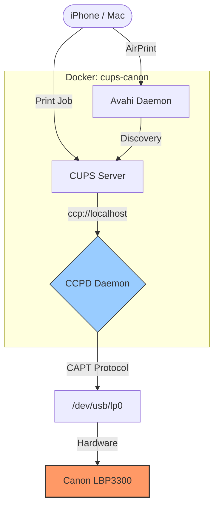

# Docker Canon LBP3300: CUPS + CAPT + AirPrint

This repository provides a Dockerized solution for the **Canon LBP3300** laser printer. This specific model requires the proprietary Canon CAPT (Canon Advanced Printing Technology) driver, which relies on a 32-bit background daemon (`ccpd`) to communicate with the hardware.

This image is optimized for **OpenMediaVault (OMV)** and other headless Linux servers.


## 🚀 Features
- **Canon CAPT v2.71 Drivers**: Pre-installed and configured for the LBP3300.
- **32-bit Compatibility**: Includes necessary `i386` libraries to run on 64-bit hosts.
- **AirPrint / Avahi**: Pre-configured for discovery on iOS and macOS.
- **Auto-Start**: Includes a custom entrypoint to ensure the `ccpd` daemon starts with the container.


## 🛠 Prerequisites

1. **Identify the USB Path**: 
   Plug in your printer and run `ls /dev/usb/`. Typically, it is `/dev/usb/lp0`.
2. **Set Host Permissions**:
   On your OMV/Host terminal, run:
   `sudo chmod 666 /dev/usb/lp0`
3. **Driver Files**:
   Place the official Canon `.deb` driver files (Common and CAPT) into a `./drivers` folder before building.

## 🔧 Architecture & Startup Pipeline

When the container launches, `/start-everything.sh` executes the following sequence:

1. **Permission Fixes:** Grants `lp:lp` ownership over `/var/spool/cups` and sets `777` write access on `/var/spool/cups/tmp` to allow `pdftops` and `pstocapt2` filters to process incoming iOS PDF print jobs.
2. **CUPS Library Audit:** Resets `/usr/lib/cups` to `755 root:root` to prevent CUPS internal security rejections.
3. **PPD & Spooler Registration:** Binds `Canon_LBP3300` using `CNCUPSLBP3300CAPTK.ppd` to the local CAPT FIFO socket `ccp://localhost:59687`.
4. **CAPT Daemon Binding:** Registers the network endpoint `ccpdadmin -p Canon_LBP3300 -o net:192.168.1.252` and restarts `/etc/init.d/ccpd`.

## 📦 Installation

### 1. Clone and Build
```bash
git clone https://github.com/YOUR_USERNAME/canon-lbp3300-docker.git
cd canon-lbp3300-docker
docker-compose up -d --build
```

### 2. Register the Hardware
Because the LBP3300 uses a specialized daemon, you must register the printer inside the container once:

```bash
# Enter the container
docker exec -it cups-canon bash

# Register with CUPS
lpadmin -p LBP3300 -m CNCUPSLBP3300CAPTK.ppd -v ccp://localhost:59687 -E

# Register with the CAPT Daemon
ccpdadmin -p LBP3300 -o /dev/usb/lp0

# Restart the daemon to apply
service ccpd restart
exit
```

## 📱 Enabling AirPrint
1. Navigate to the CUPS Web UI: `http://<your-server-ip>:631`
2. Go to **Printers** > **LBP3300**.
3. Select **Administration** > **Modify Printer**.
4. Follow the prompts and ensure **"Share This Printer"** is checked.
5. Under **Set Default Options**, ensure your Media Size (A4/Letter) is correct.


## 📝 Configuration (docker-compose.yml)
Critical notes for OMV users:
- **Network Mode**: Must be set to `host` for AirPrint discovery.
- **Devices**: You must map `/dev/usb/lp0` so the container can see the physical printer.
- **Volumes**: Mapping `/var/run/dbus` helps resolve color management errors.

## 📥 Drivers Requirement

Due to licensing restrictions, the proprietary Canon CAPT drivers are not bundled with this repository. You must download them manually and place them in the `./drivers` folder before building the image.

**Supported Driver Version:** 2.71 (or latest)  
**Download Link:** [Canon Europe - CAPT Printer Driver for Linux](https://www.canon-europe.com/support/consumer_products/products/lbp3300.html?type=drivers&os=linux%20(64-bit))

### How to prepare the drivers:
1. Download the `linux-capt-drv-v271-uk.tar.gz` (or similar) from the link above.
2. Extract the archive.
3. Locate the `64nd_deb` (or `Debian`) folder.
4. Copy these two specific files into the `drivers/` directory of this repo:
   - `cndrvcups-common_3.21-1_amd64.deb`
   - `cndrvcups-capt_2.71-1_amd64.deb`

## ⚠️ Troubleshooting

### Printer "Processing" but nothing happens
This usually means the `ccpd` daemon has lost its connection. 
- Run `docker exec cups-canon service ccpd status`.
- If it is not running, run `docker exec cups-canon service ccpd restart`.

### Check Printer & Driver Status
```bash
# Check CAPT driver binding and queue status
docker exec -it cups-airprint ccpdadmin

# Check CUPS spool queue
docker exec -it cups-airprint lpstat -o
```

### Direct Terminal Test Print
```bash
docker exec -it cups-airprint lp -d Canon_LBP3300 /etc/hosts
```

### Monitor Real-Time Logs
```bash
docker exec -it cups-airprint tail -f /var/log/cups/error_log

---

## ⚖️ License & Legal

### Repository License
The scripts, `Dockerfile`, and configuration files in this repository are provided under the **MIT License**. You are free to use, modify, and distribute them.

### Proprietary Software Notice
The **Canon CAPT (Canon Advanced Printing Technology)** drivers required for this project are the proprietary property of **Canon Inc.** - This repository **does not** bundle or redistribute the proprietary driver files.
- Users must agree to Canon's End User License Agreement (EULA) when downloading the drivers from the official Canon support website.
- The author of this repository is not affiliated with, endorsed by, or supported by Canon Inc.

---
***
